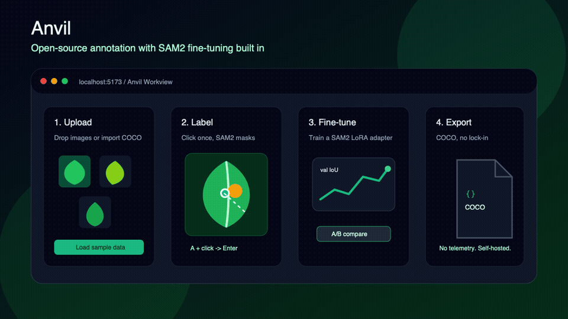

# Anvil

> Open-source image annotation platform with **built-in SAM2 fine-tuning**.

[](https://github.com/ssgaur/anvil-cv/actions/workflows/ci.yml)
[](https://opensource.org/licenses/Apache-2.0)
[]()

Anvil is an OSS alternative to V7 Labs Darwin / CVAT / Label Studio / Roboflow with one differentiator they don't have: the model **learns from your team as you label**. Annotate a few dozen images, click *Fine-tune*, and the next batch is auto-labeled by your domain-specific SAM2. Active learning surfaces the highest-uncertainty images first so every label counts more.

Runs on a **single M1 16 GB laptop** for development — no GPU cluster required.



> GIF source: `docs/assets/anvil-demo.svg`. Recording script for replacing the
> generated launch GIF with a real browser recording:
> [docs/launch/DEMO_RECORDING.md](docs/launch/DEMO_RECORDING.md)

**Privacy stance:** no telemetry, no product analytics, no phone-home. Your images,
labels, models, and users stay in your own deployment.

## Why Anvil

| | V7 Darwin | CVAT | Label Studio | Roboflow | **Anvil** |
| ------------------------------------------------ | ----------- | ---- | ------------ | -------- | ----------------- |
| Open source | no | yes | yes | partial | yes (Apache 2.0) |
| Built-in SAM2 click-to-segment | yes | no | partial/plugins | yes | yes |
| Built-in SAM2 fine-tuning (LoRA) | no | no | no | no | yes |
| Per-class IoU + A/B model compare | partial | no | no | partial | yes |
| Active-learning queue (uncertainty sort) | no | no | partial | partial | yes |
| Self-hostable, single command | no | yes | yes | no | yes |
| Spatial review comments | yes | no | partial | no | yes |
| COCO instance-seg import & export | yes | yes | yes | yes | yes |
| Telemetry-free by default | no | yes | yes | no | **yes** |
| Pricing | $500/seat/mo | free | free/enterprise | $$ | **free** |

## What works today (alpha)

- **Workview** — Polygon, Bbox (8-handle resize), Brush (paint → polygon), Polyline, Rotated bbox (OBB), Keypoints, Click-to-segment with multi-prompt SAM2, vertex editing, hold-Space pan, undo/redo, keyboard cheatsheet
- **SAM2 fine-tune** — LoRA adapter on the mask decoder, runs on M1 CPU in seconds, persisted as model versions
- **Model versions** — per-class IoU, val-IoU sparkline, side-by-side **A/B compare** with per-image deltas, set-active, delete
- **Active learning** — "Next uncertain image" queue ranks unlabeled images by model confidence
- **Review flow** — Approve / Reject / Needs-changes statuses, predefined reject reasons, **spatial pin comments** on the canvas
- **Class manager** — hierarchy tree, keypoint schemas, curated WCAG-AA palette, per-class **properties** (Single-select, Multi-select, Text)
- **Dataset ops** — server-side filters/sort, multi-select, bulk review/reset/move/delete, and clear annotations by class
- **COCO** — drag-drop ZIP import (bootstraps a dataset) and one-click instance-seg export
- **Auth + Projects** — first-run setup, RBAC, HttpOnly cookie sessions, GitHub OAuth, projects, datasets, image upload with embedding pre-compute on the worker

See [docs/FEATURES.md](docs/FEATURES.md) for the full list with screenshots and shortcuts.

## Quick start (one command)

You need **Docker** (Desktop on macOS/Windows, or Engine on Linux). That's it. No Python, no Node, no Postgres install.

```bash
git clone https://github.com/ssgaur/anvil-cv.git
cd anvil-cv
cp .env.example .env
docker compose up -d --build
```

Then open <http://localhost:5173>.

First run takes 5–10 minutes on a typical laptop — Docker pulls images, builds the services, and downloads the SAM2 base checkpoint (~700 MB) into a Docker volume. Subsequent starts take seconds.

Dev login (created by the default bootstrap):

| Email | Password |
| --- | --- |
| `admin@anvil.dev` | `admin` |

Load a small synthetic demo dataset:

```bash
python3 scripts/load_sample_dataset.py
```

It creates a project named **Anvil demo - leaves**, uploads generated PNGs, creates classes for polygon/polyline/OBB/keypoints, and adds starter annotations. No external Python packages are required.

Common operations:

```bash
docker compose logs -f --tail=100        # tail all service logs
docker compose ps                        # container status
docker compose down                      # stop everything (data preserved)
docker compose down -v                   # stop and wipe all volumes (DB, MinIO, checkpoints)
docker compose build --no-cache          # force rebuild after Dockerfile changes
```

> If you have GNU `make` installed (Linux/macOS by default; Windows via WSL or Chocolatey), there are short aliases for these — `make up`, `make down`, `make clean`, `make logs`, `make ps`, `make rebuild`. They wrap the same `docker compose` commands above. Use whichever you prefer.

Ports:

| URL                    | What                |
| ---------------------- | ------------------- |
| http://localhost:5173  | Anvil web UI        |
| http://localhost:8000  | REST API + `/docs`  |
| http://localhost:8001  | ML service          |
| http://localhost:9001  | MinIO admin console |

Hacking on the code? Use the local 3-process recipe instead — see [docs/DEV_SETUP.md](docs/DEV_SETUP.md).

## Fresh-install verification

Before launch, this was verified with:

```bash
docker compose down -v --remove-orphans
cp .env.example .env
docker compose up -d --build
docker compose ps
curl -fsS http://localhost:8000/ready
curl -fsS http://localhost:5173/ -o /dev/null
python3 scripts/load_sample_dataset.py
```

Expected result: all core containers are healthy, `/ready` responds, the web UI
loads, and the sample project appears after login.

## Repo layout

```
anvil-cv/
├── apps/
│ ├── web/ Vite + React + TS + Konva (workview canvas)
│ ├── api/ FastAPI + SQLModel + Postgres (REST + auth)
│ ├── ml/ FastAPI + SAM2 (predict, train, evaluate)
│ └── worker/ Arq jobs (embedding pre-compute, training)
├── packages/
│ └── storage/ Pluggable storage (Local / S3 / MinIO / Azure / GCS)
├── docs/ Architecture, features, fine-tune deep-dive, API ref, FAQ
├── scripts/ E2E smoke tests (one per major feature)
├── vendor/sam2/ Vendored SAM2 (Apache 2.0; see vendor/sam2/UPSTREAM.md)
└── .github/ Copilot CLI onboarding + CI workflows + issue templates
```

## Documentation

- [Architecture](docs/ARCHITECTURE.md) — services, data flow, encoder cache
- [Features](docs/FEATURES.md) — every tool with shortcuts
- [Fine-tuning deep-dive](docs/FINE_TUNING.md) — LoRA on M1, vs Meta's full fine-tune
- [API reference](docs/API.md) — all REST endpoints
- [Dev setup](docs/DEV_SETUP.md) — local 3-process recipe
- [FAQ](docs/FAQ.md)
- [Roadmap & future work](docs/ROADMAP.md)
- [Demo recording script](docs/launch/DEMO_RECORDING.md)

## Community

- [Contributing](CONTRIBUTING.md)
- [Security policy](SECURITY.md)
- [Code of conduct](CODE_OF_CONDUCT.md)
- [Changelog](CHANGELOG.md)

## License

Apache 2.0 — see [LICENSE](LICENSE).
